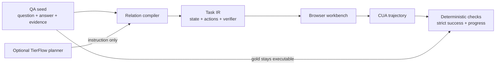

# HealthEnv

**Compile longitudinal health QA into executable, stateful, and verifiable computer-use environments.**

[中文说明](README.zh-CN.md) · [Paper draft](paper/healthenv.md) · [Task IR](docs/TASK_IR.md) · [Related work](research/RELATED_WORK.md)

Health QA benchmarks usually stop at a text answer. HealthEnv turns the same seed into a browser task: an agent must inspect a timeline, select the exact supporting records, write a grounded care note, set workflow priority, and submit. A deterministic verifier checks the final state and safety constraints.

> Status: research prototype. It is not a clinical product and must not be used for diagnosis, treatment, or patient care.

## What is new

HealthEnv treats **QA as a compact environment specification**, not merely an evaluation prompt.



The LLM may rewrite the workflow instruction, but it never defines the gold answer or verifier. That boundary is deliberate: generated prose may be useful; generated truth is not a reliable reward.

## Included vertical slice

- dependency-free Python compiler and HTTP runtime;
- a health timeline GUI with search, filtering, evidence selection, note entry, workflow state, and submission;
- exact state-based verification with five weighted checks;
- a local adapter for the public LifeAgentBench JSONL format;
- optional OpenAI-compatible synthesis through TierFlow;
- three synthetic, privacy-safe benchmark seeds covering longitudinal comparison, temporal aggregation, and cross-dimensional reasoning;
- positive and adversarial regression tests.

## Quickstart

Python 3.11+ is sufficient.

```bash
python -m pip install -e .
healthenv compile data/seeds/lifeagentbench_demo.jsonl -o generated/demo
healthenv serve generated/demo/healthenv-83c7e7283dac.json --port 8765
```

Open <http://127.0.0.1:8765>. For the first task, select the two sleeping oxygen-saturation records, write a note containing `2` and `percentage points`, set the priority to `Review`, and submit.

Run the deterministic evaluation:

```bash
python -m unittest discover -s tests -v
python scripts/demo_pipeline.py
```

The checked-in demo report is at [`artifacts/demo_results.json`](artifacts/demo_results.json).

## CLI evaluation path

The same numbers can be reproduced without a browser by emitting the oracle state and scoring it:

```bash
healthenv oracle generated/demo/healthenv-83c7e7283dac.json --output artifacts/local-oracle-state.json
healthenv verify generated/demo/healthenv-83c7e7283dac.json artifacts/local-oracle-state.json
```

`oracle` writes the deterministic gold state; `verify` scores any state file with the same five checks the browser workbench uses.

## TierFlow / OpenAI-compatible planner

HealthEnv supports an optional planner that rewrites task instructions while preserving deterministic gold state.

```bash
export TIERFLOW_BASE_URL="https://tierflow.cn/v1"
export TIERFLOW_API_KEY="..."
export TIERFLOW_MODEL="tierflow_pro"
healthenv compile data/seeds/lifeagentbench_demo.jsonl \
  -o generated/tierflow --llm
```

Secrets are read only from environment variables. `.env` files are ignored, and the key is never serialized into a task.

## LifeAgentBench adapter

The upstream LifeAgentBench repository did not expose a detected license when this prototype was built, so this repository does **not** redistribute its data. Point HealthEnv at your own local checkout:

```bash
healthenv import-lifeagent \
  /path/to/LifeAgentBench/gen_data_processed/original/single_user/single/oxygen_sat_daily/NC.jsonl \
  --line 1 \
  -o generated/lifeagent-task.json
```

The adapter preserves the QA relation but synthesizes a fresh record state. The compiled output records that upstream payloads were not redistributed.

## Task contract

A compiled task contains:

1. **Initial state** — patient-scoped longitudinal records and empty workflow state.
2. **Agent instruction** — a question expanded into an operational workflow.
3. **Action surface** — search/filter, select evidence, write note, set status, submit.
4. **Verifier** — exact evidence, required grounded terms, workflow status, explicit submission, and safety checks.
5. **Provenance** — source benchmark, seed id, compiler mode, and optional planner model.

See [`docs/TASK_IR.md`](docs/TASK_IR.md) for the JSON schema and trust boundaries.

## Current evidence

| Check | Result |
|---|---:|
| Unit/regression tests | 11 passed |
| Synthetic tasks compiled | 3/3 |
| Oracle strict success | 3/3 |
| Evidence-omission mutants rejected | 3/3 |
| LifeAgentBench-format adapter smoke | strict success 1.0 |
| TierFlow `tierflow_pro` planner | 3/3, 0 fallbacks, gold unchanged |
| Real headless-browser workflow | 100%, 0 JS/network errors |
| External dependencies in runtime | 0 |

These numbers validate the prototype plumbing, not agent capability. No model leaderboard or clinical claim is made.

## Research position

HealthEnv sits at the intersection of:

- **longitudinal health QA**, represented here by LifeAgentBench;
- **medical CUA evaluation**, represented by HealthAdminBench and MedCUA-Bench;
- **environment synthesis**, represented by InfiniteWeb, AutoWebWorld, CUA-Gym, and Gym-Anything.

The proposed research question is not “can a model answer health questions?” It is:

> Can executable QA expansion produce diverse medical computer-use environments whose rewards remain faithful, auditable, and useful for training?

The paper draft states the unproven parts explicitly: environment fidelity, transfer to real medical software, verifier validity under adversarial policies, and whether environment diversity improves CUA training.

## Safety and data governance

- Synthetic demo records only; no real patient data is included.
- Source records are read-only in the UI.
- Clinical diagnosis and treatment actions are outside the current action space.
- Gold verifiers are deterministic and separated from LLM-authored instructions.
- Exact evidence is required by default; selecting distractors fails the evidence check.
- Use of external datasets remains subject to their own licenses and governance requirements.

## Repository map

```text
src/healthenv/       compiler, adapter, runtime, verifier, server
data/seeds/          privacy-safe QA seeds
generated/demo/      compiled executable task specs
artifacts/            reproducibility results
paper/                OpenAI-style technical report draft
research/             cited evidence and reference-code ledger
tests/                deterministic regressions
```

## Citation

See [`CITATION.cff`](CITATION.cff). Until a paper version is archived, cite the repository and commit hash.

## License

Apache-2.0. External datasets and reference repositories retain their own licenses.
