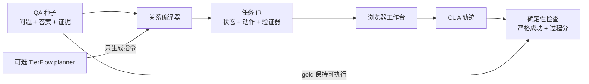

# HealthEnv

**把纵向健康 QA 编译成可执行、有状态、可验证的计算机使用环境。**

[English](README.md) · [论文草稿](paper/healthenv.md) · [任务 IR](docs/TASK_IR.md) · [相关工作](research/RELATED_WORK.md)

健康 QA 基准通常止于文本答案。HealthEnv 把同一个种子展开为浏览器任务：智能体必须检查时间线、选择精确证据、写有依据的 care note、设置流程优先级并提交；确定性验证器再检查环境末态和安全约束。

> 状态：研究原型。它不是临床产品，不能用于诊断、治疗或真实患者照护。

## 新在哪里

HealthEnv 把 **QA 当成环境规格的压缩表示**，而不只是评测 prompt。



LLM 可以改写流程指令，但不能定义 gold answer 或 verifier。生成文本可以有用，但生成的“真值”不能直接当可靠奖励。

## 已落地的垂直切片

- 零运行时依赖的 Python 编译器与 HTTP runtime；
- 支持搜索、筛选、证据选择、记录填写、流程状态和提交的健康时间线 GUI；
- 包含五项加权检查的精确状态验证器；
- 本地 LifeAgentBench JSONL 适配器；
- 通过 TierFlow 接入 OpenAI-compatible 指令合成；
- 三类隐私安全的合成任务：纵向比较、时间聚合、跨维度推理；
- 把同一契约扩展到 1200 个环境的确定性种子生成器；
- 正向 oracle 与对抗反例回归测试。

## 规模化合成

`healthenv.seedgen` 在 10 个指标域与 7 类推理技能上确定性合成 QA 种子，再把每个种子编译成环境。答案始终由生成的记录推导出来，而不是事后贴上去。

```bash
python scripts/scale_eval.py --count 1200
```

每个环境都被单独证明：oracle 轨迹达到严格成功，四个反例全部被拒绝（不选证据、全选记录、note 无依据、工作流优先级错误）。完整报告见 [`artifacts/scale_results.json`](artifacts/scale_results.json)。

| 规模指标 | 数值 |
|---|---:|
| 已编译环境 | 1200 |
| 唯一 task id | 1200 |
| Oracle 严格通过 | 1200 |
| 反例被拒绝 | 1200（每个 4 项控制） |
| 唯一（问题，答案）对 | 1193 |
| 唯一问题数 / 答案数 | 1164 / 641 |
| 结构骨架数 | 86 |

最后一行是诚实的天花板：1200 个实例落在 86 个结构骨架上（类别 × 证据数 × 干扰项数 × 优先级）。把实例数量翻上去很便宜，凭空造出真正新的推理模式才是未解问题。

## 快速运行

Python 3.11+ 即可。

```bash
python -m pip install -e .
healthenv compile data/seeds/lifeagentbench_demo.jsonl -o generated/demo
healthenv serve generated/demo/healthenv-83c7e7283dac.json --port 8765
```

浏览器打开 <http://127.0.0.1:8765>。首个任务中，选择两条睡眠时氧饱和度记录，在 note 中写入 `2` 和 `percentage points`，优先级设为 `Review`，然后提交。

运行确定性评测：

```bash
python -m unittest discover -s tests -v
python scripts/demo_pipeline.py
```

已提交的结果在 [`artifacts/demo_results.json`](artifacts/demo_results.json)。

## 命令行评测路径

不启动浏览器也能复现同样的数字：先导出 oracle 状态，再用同一套验证器打分：

```bash
healthenv oracle generated/demo/healthenv-83c7e7283dac.json --output artifacts/local-oracle-state.json
healthenv verify generated/demo/healthenv-83c7e7283dac.json artifacts/local-oracle-state.json
```

`oracle` 输出确定性 gold 状态；`verify` 用与浏览器工作台完全相同的五项检查为任意状态文件打分。

## TierFlow / OpenAI-compatible planner

HealthEnv 支持可选 planner：它只改写任务说明，不改变确定性 gold state。

```bash
export TIERFLOW_BASE_URL="https://tierflow.cn/v1"
export TIERFLOW_API_KEY="..."
export TIERFLOW_MODEL="tierflow_pro"
healthenv compile data/seeds/lifeagentbench_demo.jsonl \
  -o generated/tierflow --llm
```

密钥只从环境变量读取；`.env` 被忽略，密钥不会序列化进任务文件。

## LifeAgentBench 适配器

构建原型时，LifeAgentBench 仓库没有暴露可检测到的许可证，因此本仓库不重新分发其数据。可以指向自己的本地 checkout：

```bash
healthenv import-lifeagent \
  /path/to/LifeAgentBench/gen_data_processed/original/single_user/single/oxygen_sat_daily/NC.jsonl \
  --line 1 \
  -o generated/lifeagent-task.json
```

适配器保留 QA 关系，但重新合成一份新的 record state。生成任务会记录“未重新分发上游 payload”。

## 任务契约

每个编译后的任务包括：

1. **初始状态**：参与者范围内的纵向记录与空流程状态；
2. **任务指令**：由问题展开的操作流程；
3. **动作表面**：搜索/筛选、选择证据、写 note、设状态、提交；
4. **验证器**：精确证据、必要结论词、流程状态、显式提交、安全检查；
5. **来源记录**：基准名、种子 id、编译模式和可选 planner 模型。

JSON 规格和信任边界见 [`docs/TASK_IR.md`](docs/TASK_IR.md)。

## 当前证据

| 检查 | 结果 |
|---|---:|
| 单元/回归测试 | 27 passed |
| 编译的合成任务 | 3/3 |
| Oracle 严格成功 | 3/3 |
| 漏选证据反例被拒绝 | 3/3 |
| 规模运行：环境数 | 1200 |
| 规模运行：oracle 通过 / 反例拒绝 | 1200 / 1200 |
| 规模运行：结构错误 | 0 |
| 规模环境在真实无头浏览器中 | 100%，0 个 JS/网络错误 |
| LifeAgentBench 格式适配 smoke | strict success 1.0 |
| TierFlow `tierflow_pro` planner | 3/3，0 fallback，gold 未改变 |
| 真实无头浏览器工作流 | 100%，0 个 JS/网络错误 |
| Runtime 外部依赖 | 0 |

这些数字只验证原型管线，不代表智能体能力；当前没有模型排行榜或临床结论。

## 研究定位

HealthEnv 位于三个方向的交叉点：

- **纵向健康 QA**：以 LifeAgentBench 为代表；
- **医疗 CUA 评测**：以 HealthAdminBench、MedCUA-Bench 为代表；
- **环境合成**：以 InfiniteWeb、AutoWebWorld、CUA-Gym、Gym-Anything 为代表。

真正的问题不是“模型会不会回答健康问题”，而是：

> 可执行 QA 展开能否生成足够多样的医疗 CUA 环境，同时让奖励保持忠实、可审计，并真正对训练有用？

论文草稿明确列出尚未证明的部分：环境真实性、向真实医疗软件迁移、对抗策略下的 verifier validity，以及环境多样性是否提升 CUA 训练。

## 安全与数据治理

- 公共仓库只含合成记录，没有真实患者数据；
- UI 中源记录只读；
- 当前动作空间排除诊断、治疗和处方；
- Gold verifier 为确定性逻辑，与 LLM 指令生成分离；
- 默认必须精确选择证据，多选 distractor 会失败；
- 外部数据集仍受各自许可证和数据治理约束。

## 仓库结构

```text
src/healthenv/       编译器、适配器、runtime、verifier、server
data/seeds/          隐私安全 QA 种子
generated/demo/      编译后的可执行任务规格
artifacts/            可复现实验结果
paper/                OpenAI 风格技术报告草稿
research/             引用证据与参考代码台账
tests/                确定性回归测试
```

## 引用

见 [`CITATION.cff`](CITATION.cff)。论文归档前，请引用仓库和具体 commit hash。

## License

Apache-2.0。外部数据集和参考仓库遵循各自许可证。
