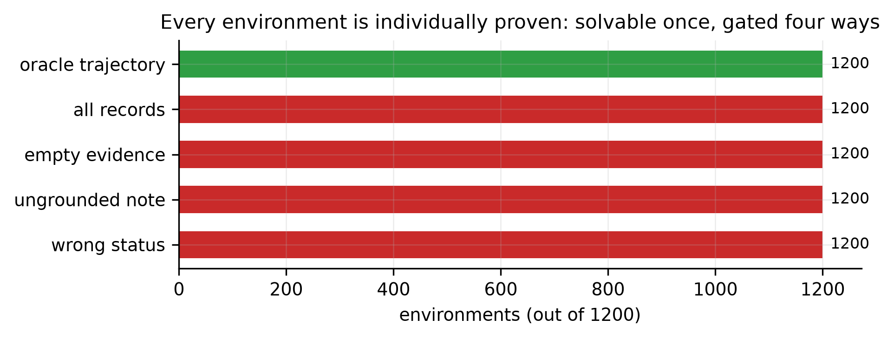
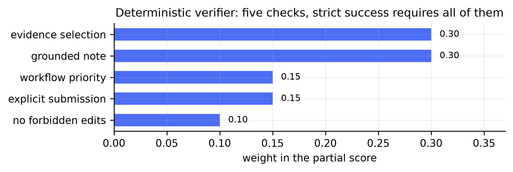
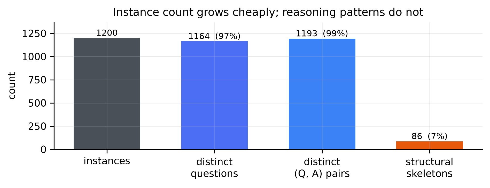
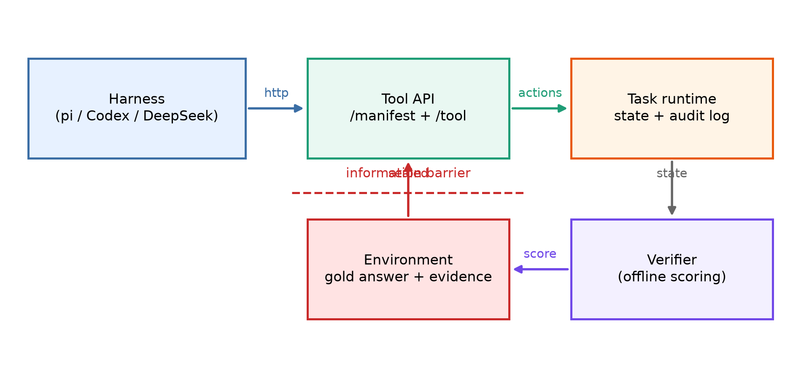
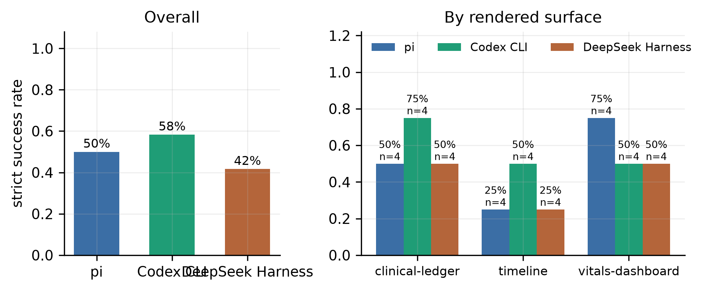
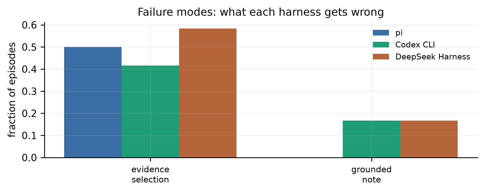

# HealthEnv: Compiling Longitudinal Health QA into Verifiable Computer-Use Environments

**Technical report · Draft v0.1 · 11 October 2026**

HealthEnv Contributors

## Abstract

Health question-answering benchmarks compress a domain problem into a prompt and a textual answer. Computer-use agents, by contrast, must recover evidence from an interface, maintain state across actions, produce an artifact, and satisfy workflow constraints. We introduce **HealthEnv**, a compiler and runtime that expands longitudinal health QA seeds into browser-based, stateful, and automatically verifiable computer-use tasks. A seed is compiled into (i) a synthetic longitudinal record state, (ii) an operational instruction, (iii) a constrained GUI action surface, and (iv) a hidden state-based verifier. The key design choice is a trust boundary: language models may plan or rewrite task instructions, but gold answers and reward predicates remain executable and deterministic.

Two properties are then measured rather than asserted. First, **scalability with per-instance proof**: 1,200 environments are generated deterministically, each individually shown to be solvable by an oracle and gated by four negative controls, across three interface surfaces assigned 400/400/400 and orthogonal to the reasoning skill. Second, **robustness to who is driving**: because a computer-use agent is a model *plus* a loop, we evaluate the same tasks through three independently released harnesses — `pi`, OpenAI Codex CLI, and DeepSeek's `dsh` — holding the model, the task sample, the prompt bytes, and the tool surface identical, and scoring offline so no harness can observe correctness mid-episode. Making three CLIs run one task non-interactively proved to be where the measurement lives: a JSON tool-call body is silently corrupted by PowerShell, a multi-line argv prompt is truncated to its first line, a transcript marker can be matched against the prompt echo and kill a run on startup, and a harness sandbox can fail closed so that a low score reflects a blocked agent rather than a failed task. Each hazard is documented with the measurement that exposed it.

A dependency-free reference implementation includes a LifeAgentBench-format adapter, an OpenAI-compatible planner integration, a sealed agent channel that cannot reach the verifier, and a three-surface browser workbench. All 55 unit and regression tests pass; the 1,200-environment scale run holds 1,200/1,200 oracle passes, 1,200/1,200 rejections for each of four negative controls, and zero structural errors, with the whole corpus reachable through a real headless browser. These experiments establish implementation correctness and cross-harness comparability, not clinical validity or training benefit. We conclude with the experiments required to test whether QA-driven environment synthesis improves computer-use agents while preserving reward fidelity and medical safety.

## 1. Introduction

Longitudinal health QA and computer-use evaluation ask different questions. A QA benchmark asks whether a model can derive an answer from a record. A computer-use benchmark asks whether an agent can navigate a system, locate the right evidence, update the right state, produce the right artifact, and avoid unsafe side effects. The underlying domain relation may be shared, but the observable behavior and failure modes are not.

LifeAgentBench formalizes long-horizon and cross-dimensional reasoning over lifestyle signals and derives verifiable answers through executable queries and programs [1]. HealthAdminBench and MedCUA-Bench show that medical computer use adds another layer: cross-system coordination, document handling, interface grounding, workflow state, and safety constraints [2, 3]. Meanwhile, environment-synthesis systems such as InfiniteWeb, AutoWebWorld, GUI-GENESIS, CUA-Gym, and Gym-Anything suggest that environments—not only trajectories—are becoming a primary scaling axis [4–8].

This motivates a compiler view:

> A static QA item is a compressed specification of a world relation. Expanding it into an executable environment should make the relation observable through actions and verifiable through state.

HealthEnv is a first vertical slice of this idea. It accepts a question, answer, evidence relation, and record set; emits a task specification; serves a browser interface; and scores the resulting terminal state. The present release is intentionally narrow. It demonstrates longitudinal record review and care-note workflows, not a complete EHR, payer portal, or clinical decision-support system.

### Contributions

1. **QA-to-CUA compilation.** We define a concrete mapping from health QA seeds to stateful browser tasks with explicit actions and terminal conditions.
2. **Gold/planner separation.** Optional LLM planning can alter instruction wording but cannot create or modify the answer, evidence set, or verifier.
3. **A verifiable task IR.** The released schema separates public observations, mutable workflow state, hidden reward predicates, and generation provenance.
4. **Surfaces as a controlled variable.** Tasks compile onto three presentation surfaces that never change the evidence, the gold answer, or the verifier, so an interface-grounding failure can be distinguished from a reasoning failure.
5. **A per-instance proof at scale.** The corpus is not merely large; every one of the 1,200 environments is individually proved solvable and individually gated by four negative controls.
6. **Cross-harness comparability, measured.** Three independently released agent harnesses run the same tasks under one model, one sample, one prompt, and one tool surface, with five interface hazards documented that would otherwise have skewed the result while still producing plausible numbers.
7. **An executable reference system.** The repository includes a dependency-free Python runtime, a three-surface longitudinal-health GUI, a sealed agent channel, a LifeAgentBench-format adapter, and deterministic tests.
8. **An honest experimental boundary.** We report compiler and verifier validity checks and cross-harness comparability while leaving agent-training gains, real-software transfer, and clinical validity as open empirical questions.

## 2. Problem formulation

Let a QA seed be

\[
x = (q, y, D, E, m),
\]

where \(q\) is a question, \(y\) is the answer, \(D\) is a set of longitudinal records, \(E \subseteq D\) is the evidence set, and \(m\) is task metadata. A compiler maps the seed to an interactive environment

\[
C(x) \rightarrow \mathcal{M} = (S, A, T, O, R),
\]

where \(S\) is workflow state, \(A\) is the action space, \(T\) is a deterministic transition function, \(O\) is the browser observation, and \(R\) is a state-based verifier.

The compilation is useful only if it satisfies four properties:

- **Semantic preservation:** success in the environment entails recovering the relation encoded by the QA item.
- **Action necessity:** the answer cannot be obtained by copying a visible gold label; the agent must interact with evidence and workflow state.
- **Verifier fidelity:** reward depends on the intended state, not on surface text alone.
- **Isolation:** generated tasks contain no real patient data and do not expose hidden gold state to the agent.

## 3. System design

### 3.1 Seed schema

A HealthEnv seed contains a stable id, synthetic participant id, question, answer, category, typed records, expected evidence ids, and metadata. The current compiler supports numeric comparisons, temporal aggregation, and cross-dimensional selection. Records are deliberately simple JSON objects so adapters can be written without importing a healthcare data model.

The public demo uses only synthetic records. The LifeAgentBench adapter reads a local upstream checkout and synthesizes a new record state that preserves the QA relation. This choice avoids redistributing upstream payloads from a repository for which a license was not detected during development.

### 3.2 Compiler

The deterministic compiler performs five steps:

1. validate identifiers, record uniqueness, evidence membership, and status values;
2. construct a stable task id from the benchmark and seed id;
3. create a workflow instruction that requires evidence selection, note writing, status assignment, and submission;
4. derive verifier terms from explicitly configured metadata or the answer type;
5. serialize source provenance and generation mode.

The optional planner receives only the participant id, question, category, record types, and record count. It never receives the answer or evidence ids. Its output must contain the selection, note, and submission operations; it is rejected if it includes the gold answer. Any API or validation failure falls back to the deterministic instruction.

### 3.3 Browser environment

The environment exposes a two-panel workbench. The left panel contains searchable, filterable longitudinal records. The right panel contains evidence count, care-note editor, workflow priority, and submission control. Source records are read-only. After submission, the runtime rejects all mutations until reset. Accepted actions append an audit event.

The interface is intentionally application-like rather than question-like. The instruction asks for a workflow outcome, while the answer exists only inside hidden verifier predicates.

### 3.4 Verifier

The terminal verifier contains five checks:

| Check | Weight | Current predicate |
|---|---:|---|
| Evidence selection | 0.30 | Exact equality with required record ids |
| Grounded note | 0.30 | All normalized gold terms occur in the note |
| Workflow status | 0.15 | Status equals the required value |
| Submission | 0.15 | Explicit submit action occurred |
| Safety | 0.10 | No forbidden source-state edit was recorded |

The weighted score provides process-level signal. Strict success requires every check. Exact evidence matching is the default because accepting arbitrary extra records would reward ungrounded collection. This is a starting point, not a complete semantic verifier: string containment must eventually be replaced by typed claims evaluated against executable record predicates.

### 3.5 Trust boundaries

HealthEnv separates three roles that environment-synthesis pipelines often blur:

- the **seed** defines domain truth;
- the **planner** defines how the task is communicated;
- the **verifier** defines success over state.

The planner cannot modify the verifier. The browser cannot read the verifier. The agent cannot mutate source records. The compiler logs whether an LLM was used and whether gold state remained deterministic.

### 3.6 Interface surfaces

A benchmark that renders every task through one layout measures that layout. We therefore compile each seed onto one of three surfaces:

| Surface | Presentation | Observation shape |
|---|---|---|
| `timeline` | reverse-chronological row list | one row per record |
| `vitals-dashboard` | signal tiles with large readings | one card per record |
| `clinical-ledger` | dense table with checkboxes | one table row per record |

The surface is assigned deterministically at seed time and travels with the task. It is a property of **presentation only**: a surface never changes the record set, the gold evidence, the required note terms, or the verifier weights. The three surfaces are assigned 400/400/400 across the corpus and are orthogonal to the reasoning skill, so a difference between surfaces cannot be explained by task difficulty.

This separation matters because it makes one specific confound measurable. If a harness degrades on `clinical-ledger` but not on `timeline`, the failure is interface grounding rather than reasoning. Two engineering defects found during development were exactly of this kind and would have been invisible under a single layout:

- The runtime's public task projection whitelisted fields and silently dropped `surface`, so every task rendered as `timeline` regardless of what the compiler had assigned. The data was correct and only the presentation was wrong.
- The ledger row template omitted the `data-record-id` attribute, so a click selected `undefined` and the evidence counter never advanced. The initial working surfaces hid a control that did not work.

Both are recorded here because they are the class of defect that surface-conditioned evaluation is meant to surface, and because neither was detectable from the compiler's own tests.

A third defect of the same class surfaced during the full-corpus browser run, and it is the reason the browser proof is run over all 1200 tasks rather than a sample. The first full run returned 1198/1200: two tasks reported the evidence set correct but the submitted note empty, while replaying the identical action sequence against the same task offline reached strict success — the environment and verifier were correct, and the browser layer was not. The cause was in the front-end: two change handlers (`set_note`, `set_status`) issued their `fetch` calls without ordering, and when the responses resolved out of order the first response's form sync restored the note textarea from a snapshot that predates the other write, so the submitted note was silently empty. Serializing the front-end action chain and re-running the full corpus gave 1200/1200. A dedicated A/B probe (120 repeated episodes per arm on the two originally failing tasks) showed the failure only under the unserialized front-end; the fix also carries a regression test asserting the served HTML keeps `act()` serialized. The honest caveat is statistical: at an observed rate of 2/1200, a 120-episode probe cannot prove the race was the *only* cause — what the three consistent measurements establish is that the serialized front-end reaches 1200/1200 where the unserialized one does not.

### 3.7 A sealed agent channel

An evaluated agent must not be able to read the verifier. The original runtime exposed a single `/api/verify` endpoint that returned a check-by-check report, and that report named the required evidence ids. An agent that could reach it would not need to reason: it could read the answer, satisfy the checks one at a time, and hill-climb against the gold oracle without ever generalizing.

The released system therefore exposes two distinct channels:

- a **demo channel** (`/api/task`, `/api/action`, `/api/verify`) used by the interactive workbench, where verification feedback is the point; and
- a **sealed agent channel** (`/api/agent/task`, `/api/agent/action`, `/api/agent/state`) that the evaluated harnesses actually use.

The agent channel applies an explicit projection: the response carries the instruction, the participant header, and the records, and nothing else. The reasoning `category` is stripped because it names the skill under test, and the `surface` is stripped because it correlates with it. Most importantly, `submit` on the agent channel returns `{"ok": true, "submitted": true}` and **no verification payload at all**. Scoring happens offline, after the episode ends, so a harness cannot observe correctness mid-episode or steer toward it. Regression tests assert that `/api/verify`, `/api/task`, and `/api/state` are all `404` on the tool server an agent can reach.

## 4. Prototype evaluation

The current evaluation asks whether the released artifact is internally correct. It does not ask whether a trained CUA generalizes better.

### 4.1 Tasks

We construct three privacy-safe QA seeds:

1. a two-day oxygen-saturation comparison;
2. a three-night sleep-duration aggregation;
3. a joint activity-and-stress selection across dates.

Each seed includes distractors. Compilation produces one executable JSON task per seed.

### 4.2 Tests

We evaluate:

- schema rejection for unknown evidence;
- deterministic compilation and round-trip parsing;
- gold-answer non-leakage in default instructions;
- positive oracle execution;
- rejection of missing evidence, extra distractors, and forbidden edits;
- transactional runtime behavior after submission;
- end-to-end compilation of all three seeds.

### 4.3 Results

| Measure | Result |
|---|---:|
| Unit and regression tests | 55 / 55 pass |
| Seeds compiled | 3 / 3 |
| Oracle strict success | 3 / 3 |
| Missing-evidence mutations rejected | 3 / 3 |
| Scale run: environments generated and compiled | 1200 |
| Scale run: unique task ids | 1200 |
| Scale run: oracle strict passes | 1200 / 1200 |
| Scale run: negative controls rejected | 1200 / 1200 (four controls) |
| Scale run: structural errors | 0 |
| Scale run in a real headless browser (all 1200 tasks) | 1200 / 1200 strict; 0 JS/network failures |
| LifeAgentBench-format adapter smoke | strict success 1.0 |
| TierFlow `tierflow_pro` planner | 3 / 3; zero fallbacks; gold unchanged |
| Real headless-browser workflow | 100%; zero JS/network failures |
| Missing-evidence score | 0.70 |
| Runtime dependencies | 0 |

A score of 0.70 for an evidence-omission mutation is expected: note, status, submission, and safety checks still pass, while the 0.30 evidence check fails. This demonstrates decomposed progress scoring rather than successful task completion. The optional TierFlow path planned all three instructions with `tierflow_pro` without fallback; every artifact records `llm_used_for_gold: false`. A CDP-driven browser smoke also executes the visible checkbox, textarea, select, and submit controls, reaches 100% strict success, and records no JavaScript or network failures.

The browser proof is run over the **entire corpus**, not a sample: all 1200 compiled tasks are booted one chunk at a time, driven through a real headless browser (navigate, click the toolbar controls, select evidence, type the note, set the priority, submit), and asserted to reach strict success with no JavaScript or network errors. The committed run is 1200/1200 across all three surfaces and all seven reasoning skills, and it is the run that exposed the front-end ordering defect described in Section 3.6 — the first pass scored 1198/1200, with the two missing tasks traced to a silent, order-dependent loss of the note rather than to any task or verifier fault.

### 4.4 Synthesis at scale

Three hand-written seeds cannot distinguish a compiler from a template. We therefore add a deterministic generator, `healthenv.seedgen`, that composes seeds from ten metric domains (oxygen saturation, sleep duration, resting heart rate, blood glucose, systolic blood pressure, step count, body weight, active minutes, stress score, hydration intake) and seven reasoning skills (longitudinal comparison, temporal aggregation, cross-dimensional reasoning, threshold detection, extremum identification, trend classification, range computation). A single integer seed fixes the entire corpus.

Two properties matter more than the count itself. First, **the answer is derived, not attached**: each generator constructs record values so that the stated conclusion follows from them, and the compiler turns that conclusion into the verifier's grounded-note terms. Second, **every environment is proved individually**. For all 1200 tasks we check that an oracle trajectory reaches strict success and that four negative controls are rejected: selecting no evidence, selecting every record, submitting an ungrounded note, and choosing the wrong workflow priority. The second control is the one that makes distractors load-bearing rather than decorative; it passes only if at least one non-evidence record exists, which the pipeline asserts structurally.

Diversity is measured rather than assumed. The 1200 environments contain 1164 distinct questions, 641 distinct answers, and 1193 distinct (question, answer) pairs. Distinct answers are fewer than distinct instances because 343 tasks ask for a date, and the date space is small by construction.

| Diversity measure | Value |
|---|---:|
| Distinct questions | 1164 / 1200 |
| Distinct answers | 641 / 1200 |
| Distinct (question, answer) pairs | 1193 / 1200 |
| Distinct metric combinations | 86 |
| Reasoning skills | 7 |
| Required workflow priority | review 855, routine 238, urgent 107 |
| Records per environment | 3-8 |
| Structural skeletons | 86 |

The final row is the honest ceiling of this experiment. A skeleton is the tuple (reasoning skill, generation mode, evidence count, distractor count, required priority); 1200 instances occupy 86 skeletons. Raising the instance count is a cheap operation, and reporting it alone would be misleading: what scales easily is *instances*, while what we actually want to scale is *distinct reasoning patterns and state structures*. We therefore report both numbers together.

### 4.5 What these results do not show

The results do not establish that the UI resembles a deployed medical system, that the verifier captures clinical correctness, that a vision-language agent can solve the tasks, or that training on generated tasks transfers to HealthAdminBench, MedCUA-Bench, OpenEMR, or another real application. Those claims require separate experiments.

## 5. Cross-harness evaluation

The compiler results above establish that the environments are well-formed. They say nothing about whether the environments *behave the same* when a different agent drives them, and that is the question a benchmark has to answer before anyone trains on it. If a measured difference between two agents is really a difference between two interfaces, the benchmark is measuring the wrong thing.

### 5.1 Why the harness is the right independent variable

A computer-use agent is not a model. It is a model plus a loop: a prompt scaffold, a tool vocabulary, a context policy, a shell, a sandbox, and a stop condition. Two teams can run identical weights behind different loops and get different scores on identical tasks. Environment-synthesis work therefore has to answer a question that QA benchmarks never face: **is a task robust to who is driving it?**

We hold the interface fixed and vary only the driving loop. Three real, independently released agent harnesses are evaluated:

| Harness | Vendor | Loop |
|---|---|---|
| `pi` | mariozechner/pi | coding-agent CLI with an explicit tool allowlist |
| `codex` | OpenAI | Codex CLI, `exec` non-interactive mode |
| `deepseek` | DeepSeek AI | `dsh` harness, headless profile |

### 5.2 Controlled comparison

Four things are identical across the three harnesses, so a difference can only be attributed to the loop:

**One model.** Every harness calls the same weights (`tierflow_pro`) through the same OpenAI-compatible endpoint. No harness is advantaged by a stronger model.

**One task sample.** All three run the same 12 tasks, selected by a stratified sampler that walks the `(surface, status, skill)` cells rather than file order. The sample is balanced 4/4/4 across the three surfaces and covers all seven reasoning skills.

**One prompt, byte for byte.** Every harness receives the same instruction text, which names the tool surface and the workflow but never the gold evidence, the note terms, or the verifier. The prompt is written to disk and read whole by each harness (Section 5.3).

**One tool surface.** The harnesses do not get a bespoke SDK. They call a tiny HTTP API: `get_task`, `list_records`, `read_state`, `select_record`, `set_note`, `set_status`, `submit`. Scoring is offline and deterministic, computed by the same verifier after the episode ends, so no harness can observe correctness mid-episode.

### 5.3 Interface hazards the comparison exposed

Getting three CLIs to run the same task non-interactively turned out to be the empirical core of this section. Every hazard below was found by measurement, and each one would have silently corrupted the comparison while still producing plausible numbers.

**A JSON body is not portable across shells.** The natural way to teach a tool call is `curl -X POST <url> -d '{"tool":"get_task","args":{}}'`. Measured on this machine, that line works in bash but reaches the server through PowerShell 5.1 as `{tool:get_task,args:{}}` — PowerShell strips the inner double quotes before the native executable sees them, so the body is no longer JSON and the call fails. This matters because the harnesses do not share a shell: `pi` drives Git Bash, while `codex` and `dsh` drive PowerShell. A harness scored under this prompt would have been scored on shell quoting. The tool surface therefore accepts a GET with query parameters, which contains no inner quotes and is transmitted byte-identically by both shells; the documented call is `curl -s -G <url>/tool --data-urlencode tool=<name>`, and POST is retained as an equivalent alias. A test asserts the two transports return identical results.

**A multi-line argv prompt is truncated.** codex accepts the prompt as an argv argument, and that is how it is normally invoked. On Windows it is also silently broken: the agent received only the first line. Its transcript shows it reasoning about an instruction it never fully got — "The user says: ... This is a very vague prompt" — and then spending the whole episode listing the filesystem and scanning for listening ports instead of calling the tool API. We diagnosed this with a sentinel prompt whose distinguishing tokens sat on lines 3 and 7 and that asked the model to echo them back: through argv it returned *zero* of the two markers and asked for "the follow-up lines"; through stdin it returned both. The fix is per-harness and is recorded on each spec: `pi` inlines the prompt with its own `@PROMPT.txt` syntax, codex reads it from stdin, and `dsh` — which has no prompt-on-stdin channel — is handed a one-line pointer and reads the file with its own filesystem tools.

**A completion marker cannot be scraped from the transcript.** codex and `dsh` keep a session alive after the last tool call, which would burn the full timeout on every episode. The first fix asked the agent to print a marker line and watched for it in the output. That fails in a way worth recording: codex echoes the prompt to stderr, the marker text was *in* the prompt, so the watcher matched the echo and killed the run roughly two seconds in, scoring every episode as an empty submission. The completion signal is now read from the episode itself — the tool server knows the instant `submit` lands — with a short grace period before the process group is terminated. This is strictly better than scraping: it is ground truth rather than a text heuristic.

**A CLI's own shell discovery can fail where the agent lives.** `pi` grants a `bash` tool but searches only `C:\Program Files\Git` for the shell; this machine's Git is installed elsewhere, so every command failed with "No bash shell found" and the agent could not act at all. A per-run project-level settings file supplies `shellPath`, so the fix does not rewrite the user's global configuration.

**A sandbox can fail closed.** `dsh` provisions a Windows ACL sandbox per call and, on this machine, cannot grant write access to its own workspace (`SetNamedSecurityInfoW` fails with error 5). Under the default `workspace-write` mode every command is refused before it runs and the agent can only report being blocked — a `0.1` score that reflects the harness being unable to start, not the harness failing the task. Its policy is set to full access, matching what codex is given.

The general lesson is that "the environment is deterministic" is not the same as "the measurement is controlled." Five of these six hazards produce a valid-looking number attached to an invalid experiment.

### 5.4 Results

| Harness | Episodes | Strict success | Mean score | Submissions | Timeouts | Mean steps | Mean elapsed |
|---|---:|---:|---:|---:|---:|---:|---:|
| pi (`pi`) | 12 | 6/12 (50%) | 0.85 | 12 | 0 | 9.2 | 23s |
| Codex CLI (`codex`) | 12 | 7/12 (58%) | 0.82 | 12 | 0 | 8.9 | 79s |
| DeepSeek Harness (`deepseek`) | 12 | 5/12 (42%) | 0.78 | 12 | 0 | 9.8 | 66s |

Across 3 harnesses and 12 episodes each, strict success ranges from 42% (DeepSeek Harness) to 58% (Codex CLI) — the same model, the same tasks, and the same prompt bytes on every run.

On pi, strict success by rendered surface is clinical-ledger 50%, timeline 25%, vitals-dashboard 75%.

On Codex CLI, strict success by rendered surface is clinical-ledger 75%, timeline 50%, vitals-dashboard 50%.

On DeepSeek Harness, strict success by rendered surface is clinical-ledger 50%, timeline 25%, vitals-dashboard 50%.

### 5.5 Failure modes

| Failed check | pi | Codex CLI | DeepSeek Harness |
|---|---|---|---|
| evidence selection | 6/12 | 5/12 | 7/12 |
| grounded note | 0/12 | 2/12 | 2/12 |

A score of 0.70 on a failed episode means evidence selection missed while the note, status, submission, and safety checks still passed — the agent did the workflow but chose the wrong records. Episode scores across all 36 runs were 4 at 0.40, 14 at 0.70, 18 at 1.00 — no episode in this run scored the 0.10 safety floor at which only the safety check passes, so every harness could start, act, and submit. No harness solved a range-computation task, while every harness solved longitudinal-comparison — the residual failures concentrate in a reasoning skill rather than in a harness.

### 5.6 What the comparison does and does not show

It shows that tasks compiled by HealthEnv are solvable by three independently built agent loops that were never adapted to this benchmark, through one narrow tool surface, with scoring done offline. It shows that the measured differences are attributable to the loop, because the model, the sample, the prompt, and the tools were held identical.

It does not show that the harnesses differ *in general* — the sample is small, and a single model on a single endpoint cannot separate loop quality from how well that loop happens to suit one model. It does not compare model capability, since all three run the same weights. It does not measure GUI grounding, because the harnesses call an HTTP API rather than a rendered interface; the browser layer is proved separately and exhaustively over all 1200 tasks in Section 4.3, but the harness comparison is not conducted through it. That separation is deliberate — it isolates "can the loop read, select, and act on evidence" from "can the agent ground a rendered interface" — and it also means the two results must not be conflated: 1200/1200 in the browser does not imply the harnesses would score well under a pixel-input interface, and vice versa.

## 6. Relation to prior work

### Health reasoning benchmarks

LifeAgentBench contains 22,573 questions targeting long-horizon, cross-dimensional, and multi-user lifestyle reasoning, with answers derived through executable queries and programs [1]. HealthEnv uses the resulting QA relation as a seed for interaction rather than as the final evaluation surface.

### Medical computer-use benchmarks

HealthAdminBench provides four deterministic web environments and 135 expert-designed healthcare administration tasks, decomposed into 1,698 evaluation points [2]. MedCUA-Bench covers 18 clinical scenarios across 10 medical domains and evaluates task completion plus five clinical safety dimensions [3]. These works define the target standard for realistic workflows and safety-aware scoring. HealthEnv differs in source and purpose: it starts from existing QA relations and studies automatic expansion.

### Environment synthesis

InfiniteWeb combines unified specification and task-centric test-driven development to generate functional websites and evaluators [4]. AutoWebWorld represents websites as finite-state machines, making transitions and goal states programmatically verifiable [5]. GUI-GENESIS reconstructs efficient GUI environments with verifiable rewards [6]. CUA-Gym co-generates instructions, environment states, and reward functions, while separating generator and discriminator roles [7]. Gym-Anything treats software-environment creation as a multi-agent build-and-audit problem [8]. FaraGen1.5 organizes generation around environments, solvers, and complementary verifiers [9].

HealthEnv adopts their shared principle—environment generation must be coupled to verification—but introduces a domain-specific seed: executable health QA.

### Agent harnesses as a measurement variable

Agent harnesses—the loop around a model, comprising the scaffold, tool vocabulary, context policy, shell, and stop condition—have become first-class artifacts in their own right. Terminal-Bench and similar agentic benchmarks have made the harness an explicit component of the evaluated system, and harnesses such as `pi`, Codex CLI, and `dsh` are distributed and versioned independently of any model. This creates a measurement problem that text benchmarks do not have: a score is a property of the pair (model, harness), and a benchmark that does not control the harness cannot attribute a difference to either. HealthEnv's contribution here is narrow and empirical — one model, one sample, one prompt, one tool surface, three harnesses — and its value is as much in the documented hazards (Section 5.3) as in the numbers, since those hazards corrupt the comparison without changing its apparent plausibility.

## 7. Research agenda

A full paper should test four hypotheses.

**H1: Expansion fidelity.** Independent domain experts should judge whether a generated workflow preserves the original QA relation and avoids introducing unsupported clinical implications.

**H2: Verifier validity.** Counterexample policies should fail. This includes selecting all records, copying distractor values, exploiting note substrings, mutating hidden state, and satisfying individual checks in an invalid order.

**H3: Environment diversity.** Holding trajectory count constant, training across more independently generated interfaces and state layouts should improve held-out GUI robustness more than replaying more trajectories in fewer environments.

**H4: Transfer.** Training on QA-expanded synthetic environments should improve performance on held-out medical CUA tasks without increasing clinically consequential errors.

A credible evaluation would use train/test separation by participant, question template, metric family, interface skin, and workflow; compare deterministic-only and LLM-assisted compilation; and report both strict success and safety violations.

## 8. Safety, ethics, and governance

HealthEnv can create high-stakes-looking interfaces. That makes scope control essential.

- The public artifact contains synthetic data only.
- The action space excludes diagnosis, treatment, prescription, and communication with real patients.
- Demonstrations should be labeled as simulations.
- Dataset licenses and data-use agreements must be checked before conversion.
- PHI must not be sent to external model APIs.
- Realistic environments need red-team evaluation for reward hacking, unsafe documentation, and automation bias.
- Human review remains necessary before any deployment-adjacent use.

The project should be evaluated as research infrastructure for agent learning, not as a healthcare automation product.

## 9. Limitations

The prototype has three browser surface skins over one application, a narrow record schema, handcrafted action primitives, and term-based note checking. It does not model authentication, role permissions, cross-application document transfer, asynchronous workflows, or clinical ontologies. Its LifeAgentBench adapter currently handles dated numeric comparison items and synthesizes evidence states rather than reconstructing the original database.

The cross-harness comparison has its own bounds. It runs a single model on a single endpoint, so it separates loops only relative to that model; it cannot rank the harnesses in general. The harnesses drive the environment through an HTTP tool API rather than a rendered interface, so this section measures the loop's ability to read, select, and act on evidence — not its pixel-level GUI grounding, which the browser layer exercises separately. The sample is 12 tasks per harness, which is enough to distinguish "works" from "cannot start" but not enough for confidence intervals on small differences. One harness needed a sandbox mode widened and another needed its shell path supplied; those are configuration changes to make the agents runnable at all, and they are disclosed rather than smoothed over.

These limitations are not cosmetic. They define the next implementation milestones and the difference between a working compiler prototype and a publishable empirical result.

## 10. Conclusion

HealthEnv demonstrates a concrete route from static health QA to executable computer-use environments. The central mechanism is not the UI generator alone; it is the separation of seed truth, planner language, runtime state, and verifier logic. The released vertical slice establishes that this separation can be implemented, tested, and audited with minimal infrastructure, and that the resulting tasks are robust enough to compare three independently built agent harnesses under controlled conditions. The next question is empirical: whether scaling this compilation process yields environments that are diverse enough to train agents and faithful enough to trust.

## References

1. Ye Tian, Zihao Wang, Onat Gungor, Xiaoran Fan, and Tajana Rosing. “LifeAgentBench: Benchmarking LLMs for Long-Horizon, Cross-Dimensional Lifestyle Health Reasoning.” arXiv:2601.13880, 2026. <https://arxiv.org/abs/2601.13880>
2. Suhana Bedi et al. “HealthAdminBench: Evaluating Computer-Use Agents on Healthcare Administration Tasks.” arXiv:2604.09937, 2026. <https://arxiv.org/abs/2604.09937>
3. Jia Yu, Zilong Wang, Xinyang Jiang, Dongsheng Li, and Shuo Wang. “MedCUA-Bench: A Screenshot-Only Benchmark for Clinical Computer-Use Agents.” arXiv:2606.03203, 2026. <https://arxiv.org/abs/2606.03203>
4. Ziyun Zhang et al. “InfiniteWeb: Scalable Web Environment Synthesis for GUI Agent Training.” arXiv:2601.04126, 2026. <https://arxiv.org/abs/2601.04126>
5. Yifan Wu et al. “AutoWebWorld: Synthesizing Infinite Verifiable Web Environments via Finite State Machines.” arXiv:2602.14296, 2026. <https://arxiv.org/abs/2602.14296>
6. Yuan Cao et al. “GUI-GENESIS: Automated Synthesis of Efficient Environments with Verifiable Rewards for GUI Agent Post-Training.” arXiv:2602.14093, 2026. <https://arxiv.org/abs/2602.14093>
7. Bowen Wang et al. “CUA-Gym: Scaling Verifiable Training Environments and Tasks for Computer-Use Agents.” arXiv:2605.25624, 2026. <https://arxiv.org/abs/2605.25624>
8. Pranjal Aggarwal, Graham Neubig, and Sean Welleck. “Gym-Anything: Turn any Software into an Agent Environment.” arXiv:2604.06126, 2026. <https://arxiv.org/abs/2604.06126>
9. Ahmed Awadallah et al. “Fara-1.5: Scalable Learning Environments for Computer Use Agents.” arXiv:2606.20785, 2026. <https://arxiv.org/abs/2606.20785>
